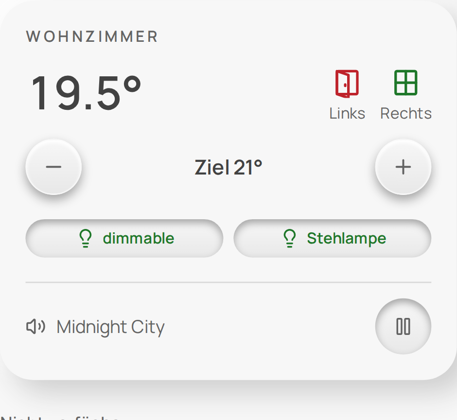
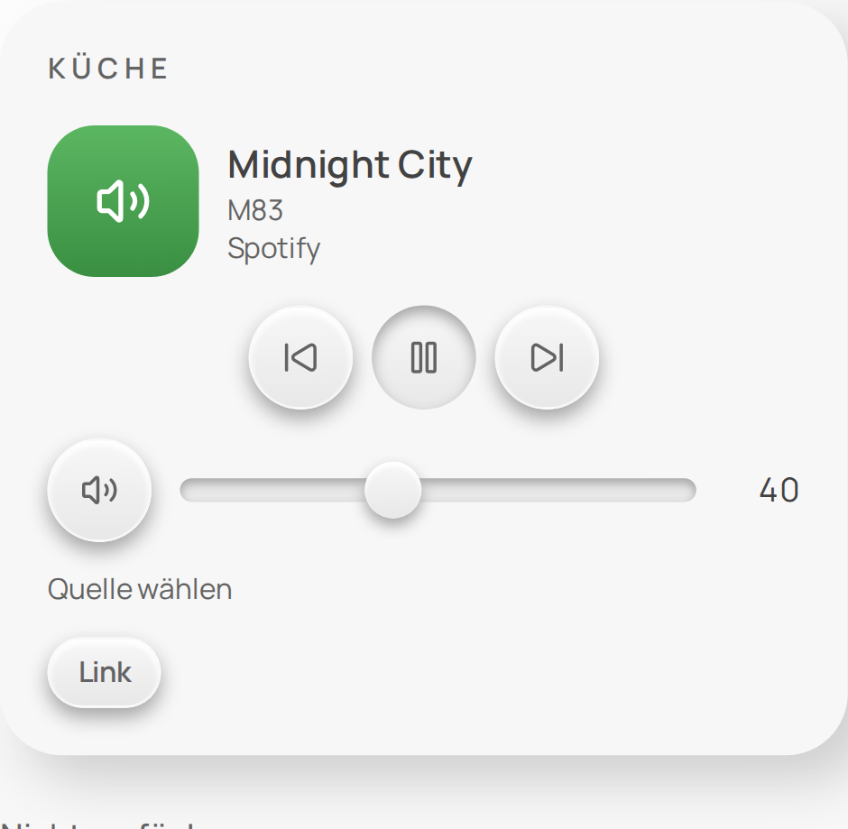
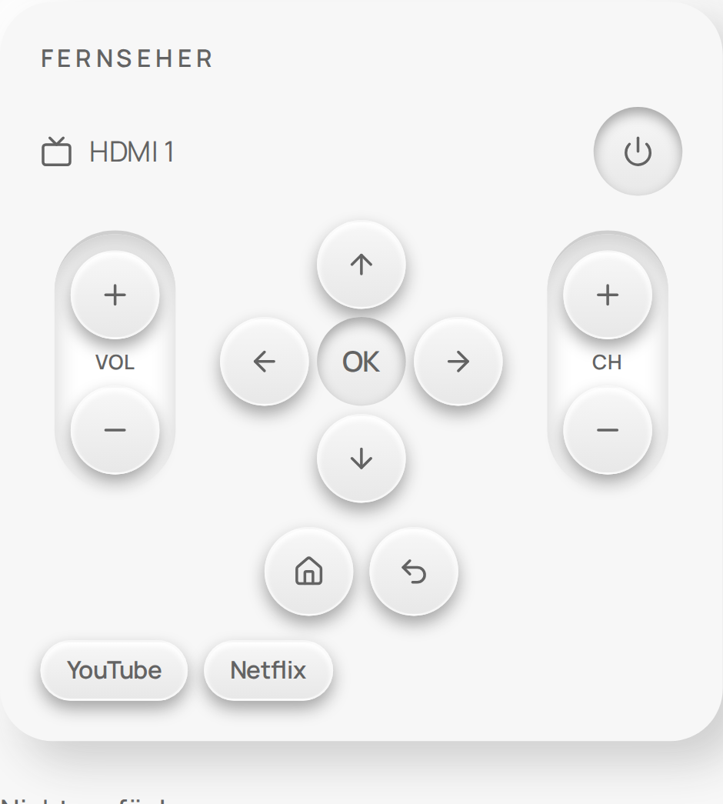
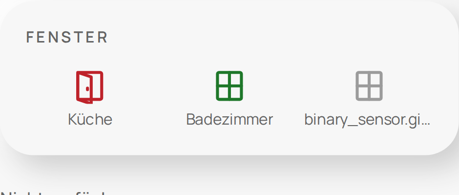

# Octa Home UI

Eigene Karten, ein Theme und eine Dashboard-Strategie für [Home Assistant](https://www.home-assistant.io/). Die Karten funktionieren einzeln in eigenen Dashboards, und jede Liste lässt sich im grafischen Karten-Editor oder per YAML pflegen.

**Dokumentation:** [Installation](INSTALLATION.de.md) · [Beispiele](EXAMPLES.de.md) · [YAML-Referenz](docs/YAML-REFERENCE.de.md) · [Roadmap](docs/ROADMAP.de.md) · [English](README.md)

| Raum | Lautsprecher | Fernbedienung | Fenster |
|---|---|---|---|
|  |  |  |  |

> Stand: Vorabversion, getestet mit Home Assistant 2026.9.4. Andere Versionen sind ungetestet.

## Karten

| Karte | Zweck |
|---|---|
| `octa-room-card` | Heizung, Licht, Fenster und Medien eines Raums in einem Block |
| `octa-contacts-card` | beliebig viele Fenster- und Türkontakte, Zustand als Icon |
| `octa-media-card` | Lautsprecher-Block mit Quellenwahl, Lautstärke, Sendern, TV-Fernbedienung mit App-Knöpfen |
| `octa-light-card`, `octa-switch-card`, `octa-scene-card` | Licht, Schalter, Szenen |
| `octa-climate-card`, `octa-air-card`, `octa-cover-card` | Klima, Lüfter und Ventile, Abdeckungen |
| `octa-sensor-card`, `octa-energy-card`, `octa-weather-card` | Sensoren, Energie, Wetter |
| `octa-security-card`, `octa-camera-card` | Schlösser, Alarm, Kontakte, Personen, Kameras |
| `octa-system-card`, `octa-appliance-card`, `octa-input-card` | Server- und Docker-Status (nur Anzeige), Haushaltsgeräte, Helfer |

## Was getestet wurde

| Getestet mit | Karten |
|---|---|
| Echten Geräten | Licht, Schalter, Klima, Wetter, Google-Cast-Lautsprecher, Samsung-TV-Fernbedienung, Fensterkontakte, Raum-Block, Kamera mit Standbild-Quelle |
| Echten Daten in einer Testinstanz | Serverstatus über System Monitor, Docker-Werte |
| Nur simulierten Geräten | Abdeckungen und Garagentore, Schlösser, Alarm, Szenen, Lüfter und Ventile, Sensoren, Energie, Saugroboter, Waschmaschine, Eingaben, Dashboard-Strategie |

Simuliert heißt: Logik und Oberfläche wurden mit der Demo-Integration von Home Assistant geprüft, aber keine Eigenheiten der Hersteller. Ein echter Videostream ist nicht getestet. Spotify ist vorbereitet, aber zurückgestellt. Details stehen in der [Roadmap](docs/ROADMAP.de.md).

## Sicherheit

Entriegeln, Unscharfschalten ohne Code und das Öffnen von Garagentoren, Toren und Türen fragen immer nach, nennen Gerät und Wert und verfallen nach 15 Sekunden. Alarm-Codes werden nur auf der Karte eingegeben und nie in einer Konfiguration gespeichert. Geheimnisse in einer Kartenkonfiguration werden abgelehnt. Der Docker-Status ist reine Anzeige.

## Installation

ZIP eines Releases herunterladen und [INSTALLATION.de.md](INSTALLATION.de.md) folgen. Eine Installation über HACS ist geplant.

## Entwicklung

Node und Browser laufen in einem festen Container, nötig ist nur Docker:

```sh
tools/dev.sh pnpm install --frozen-lockfile
tools/dev.sh pnpm check
```

## Lizenz

[MIT](LICENSE). Hinweise zu Fremdsoftware stehen in `apps/cards/THIRD_PARTY_LICENSES.txt`.
