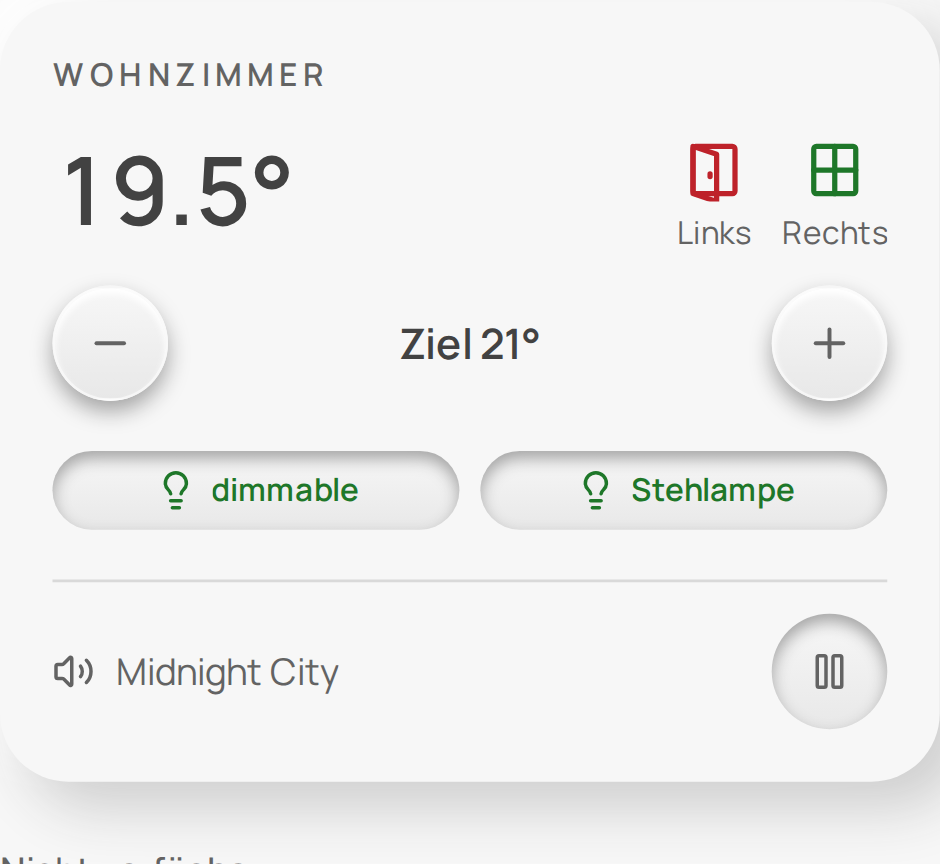
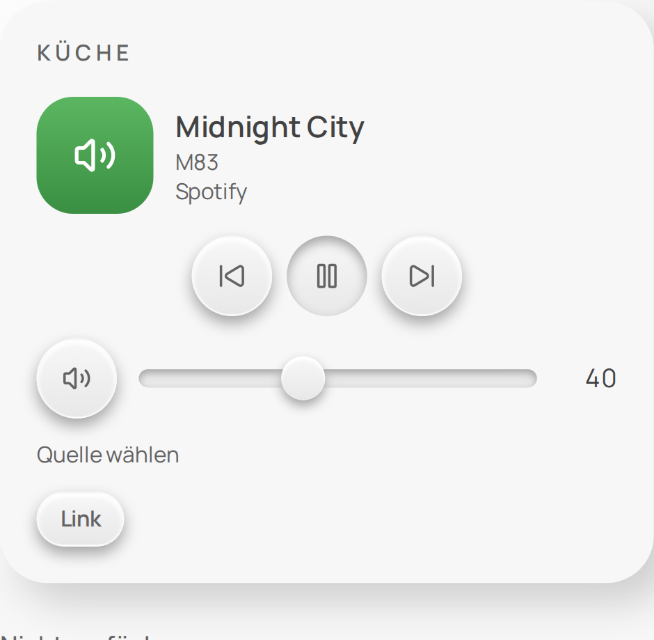
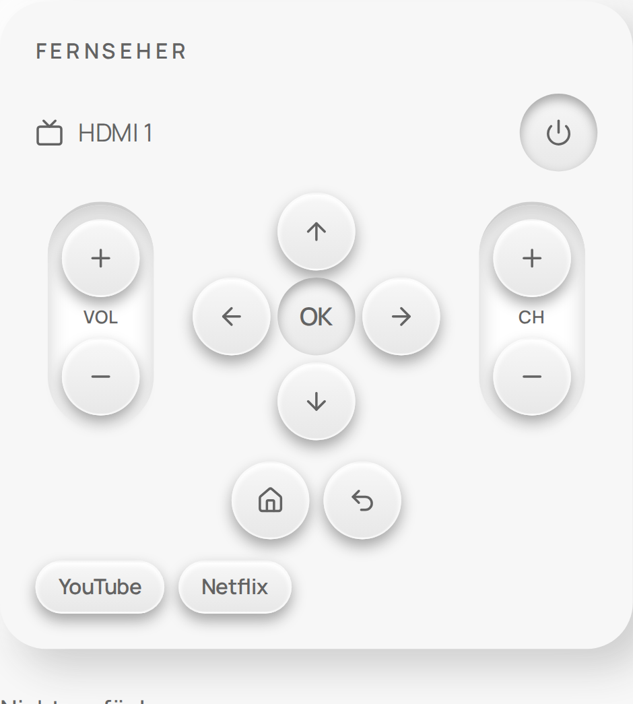
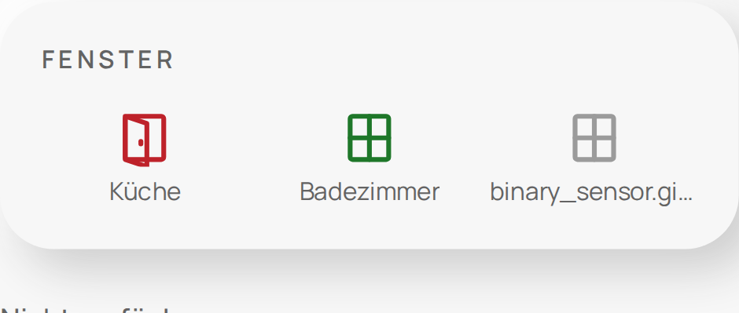

# Octa Home UI

Custom cards, a theme and a dashboard strategy for [Home Assistant](https://www.home-assistant.io/). The cards work on their own in your dashboards, and every list can be maintained in the visual card editor or in YAML.

**Documentation:** [Installation](INSTALLATION.md) · [Examples](EXAMPLES.md) · [YAML reference](docs/YAML-REFERENCE.md) · [Roadmap](docs/ROADMAP.md) · [Deutsch](README.de.md)

| Room | Speaker | Remote | Windows |
|---|---|---|---|
|  |  |  |  |

> Status: pre-release, tested with Home Assistant 2026.9.4. Other versions are untested.

## Cards

| Card | Purpose |
|---|---|
| `octa-room-card` | heating, lights, windows and media of one room in one block |
| `octa-contacts-card` | any number of window and door contacts, state shown as an icon |
| `octa-media-card` | speaker block with source selection, volume, stations, TV remote with app buttons |
| `octa-light-card`, `octa-switch-card`, `octa-scene-card` | lights, switches, scenes |
| `octa-climate-card`, `octa-air-card`, `octa-cover-card` | climate, fans and valves, covers |
| `octa-sensor-card`, `octa-energy-card`, `octa-weather-card` | sensors, energy, weather |
| `octa-security-card`, `octa-camera-card` | locks, alarm, contacts, persons, cameras |
| `octa-system-card`, `octa-appliance-card`, `octa-input-card` | server and Docker status (read only), appliances, helpers |

## What has been tested

| Tested with | Cards |
|---|---|
| Real devices | light, switch, climate, weather, Google Cast speaker, Samsung TV remote, window contacts, room block, camera with a still image source |
| Real data in a test instance | server status via System Monitor, Docker figures |
| Simulated devices only | covers and garage doors, locks, alarm, scenes, fans and valves, sensors, energy, vacuum, washer, inputs, dashboard strategy |

Simulated means the logic and interface were checked with the Home Assistant demo integration, but no vendor specifics. A real video stream has not been tested. Spotify is prepared but on hold. Details are in the [roadmap](docs/ROADMAP.md).

## Safety

Unlocking, disarming without a code and opening garage doors, gates and doors always ask first, name the device and value, and expire after 15 seconds. Alarm codes are only entered on the card and are never stored in a configuration. Secrets in a card configuration are rejected. Docker status is read only.

## Installation

Install through HACS as a custom repository, or download the ZIP of a [release](https://github.com/octa-vx/octa-home-ui/releases). Both are described in [INSTALLATION.md](INSTALLATION.md).

## Development

Node and browsers run in a pinned container, so only Docker is required:

```sh
tools/dev.sh pnpm install --frozen-lockfile
tools/dev.sh pnpm check
```

## License

[MIT](LICENSE). Third-party notices are in `apps/cards/THIRD_PARTY_LICENSES.txt`.
